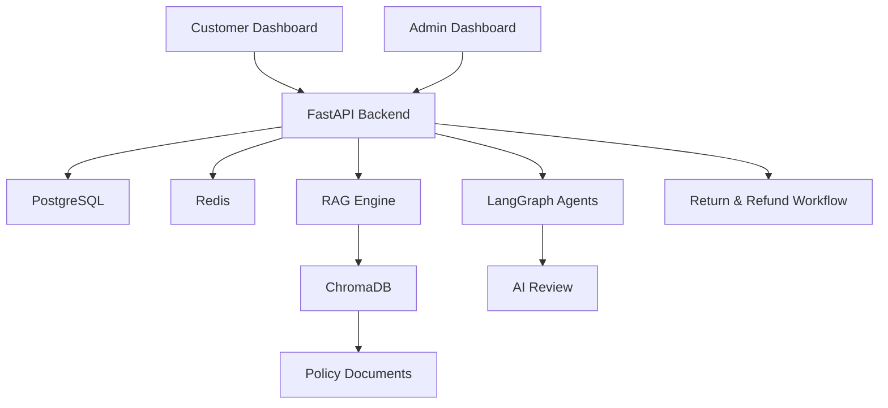

# 🔄 ReturnFlow

### AI-Powered E-Commerce Returns & Refund Management Platform

ReturnFlow is an AI-powered platform designed to simplify e-commerce returns and refunds. It combines rule-based return eligibility, Retrieval-Augmented Generation (RAG), and AI agents to help customers manage returns and assist administrators in reviewing return requests.

## ✨ Features

- 📦 Order and return management
- 📋 Automated return eligibility checking
- 🤖 AI-powered return review
- 🧠 RAG-based return policy assistant
- 📚 Store-specific knowledge base
- 🔄 LangGraph multi-agent workflow
- 💰 Refund workflow simulation
- 🚚 Return shipment tracking workflow
- 📊 Admin dashboard and analytics
- 🔐 Authentication and role-based access control
- 🏢 Multi-store data isolation
- 📄 PDF and document-based policy knowledge
- 🐳 Docker-based deployment

## 🏗️ Architecture



## 🛠️ Tech Stack

| Category | Technology |
|---|---|
| Frontend | React, TypeScript, Vite, Tailwind CSS |
| Backend | Python, FastAPI |
| Database | PostgreSQL, SQLAlchemy |
| Migrations | Alembic |
| Cache | Redis |
| AI | Gemini API |
| RAG | LangChain, ChromaDB, Sentence Transformers |
| Agents | LangGraph |
| Authentication | JWT, Argon2 |
| Testing | Pytest |
| Deployment | Docker, Docker Compose, Nginx |

## ⚙️ Installation & Setup

### 1️⃣ Clone the repository

```bash
git clone https://github.com/YOUR_USERNAME/ReturnFlow.git
cd ReturnFlow
```

### 2️⃣ Configure environment variables

```bash
cp .env.example .env
```

Update the `.env` file with your local configuration and secure credentials.

### 3️⃣ Build Docker containers

```bash
docker compose --profile full build
```

### 4️⃣ Start the application

```bash
docker compose --profile full up -d
```

### 5️⃣ Access the application

| Service | URL |
|---|---|
| 🌐 Frontend | http://localhost:8080 |
| ⚡ API | http://localhost:8080/api/v1 |
| 📖 API Documentation | http://localhost:8080/docs |

## 🧪 Testing

Run backend tests:

```bash
pytest -v
```

Build frontend:

```bash
cd frontend
npm install
npm run build
```

## 🐳 Docker Commands

```bash
# Build services
docker compose --profile full build

# Start services
docker compose --profile full up -d

# View running containers
docker compose ps

# View logs
docker compose logs -f

# Stop services
docker compose --profile full down
```

## 🤖 AI Workflow

ReturnFlow combines deterministic business rules with AI assistance.

- **Eligibility Engine** – evaluates return rules and order data.
- **Policy RAG** – retrieves relevant store policy information.
- **Intake Agent** – summarizes the return request.
- **Policy Research Agent** – retrieves policy evidence.
- **Eligibility Agent** – evaluates deterministic results.
- **Resolution Agent** – recommends possible resolutions.
- **Review Agent** – checks consistency and missing information.
- **Finalization Agent** – prepares the final review for human approval.

AI agents assist with decision-making but cannot independently execute real refunds.

## 🔒 Security

- JWT authentication
- Argon2 password hashing
- Role-based permissions
- Store-level data isolation
- File upload validation
- Rate limiting
- Audit logging
- Environment-based secrets

## 📌 Current Limitations

- LLM and embedding configurations may use mock providers by default.
- Refund and shipping workflows use simulated providers.
- Real payment processing and carrier integrations are not enabled by default.
- AI responses depend on configured models and available policy documents.

## 🎯 Project Goal

To build a practical AI-powered e-commerce returns platform combining backend engineering, Generative AI, RAG, agent workflows, and automated business processes.

---

⭐ If you find this project interesting, feel free to explore or contribute.

**Built with ❤️ using AI & Software Engineering.**
