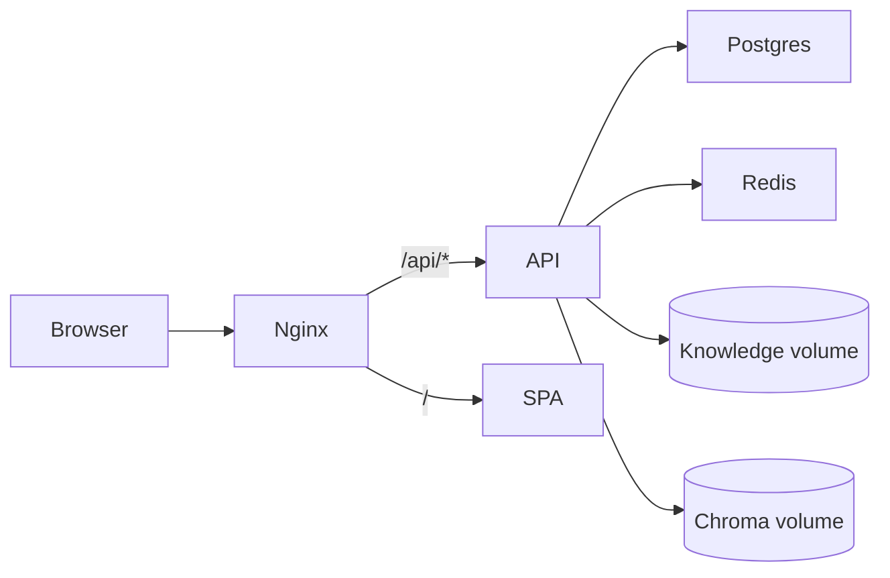

# Deployment guide

ReturnFlow **v0.11.0** supports local hybrid dev (Vite + uvicorn + Compose infra) or an all-in-Docker stack.

## Architecture (Docker full stack)



| Service | Image | Port (default) |
| --- | --- | --- |
| `web` | `returnflow-web:local` | 8080 |
| `api` | `returnflow-api:local` | 8000 (optional) |
| `postgres` | `postgres:16-alpine` | 5432 |
| `redis` | `redis:7-alpine` | 6379 |

The SPA is built with an **empty** `VITE_API_BASE_URL` so the browser calls same-origin `/api/v1/...` through nginx.

## Prerequisites

- Docker Desktop / Compose v2
- `.env` copied from `.env.example` with real `POSTGRES_PASSWORD` and `JWT_SECRET` (32+ characters)

## Infrastructure only (local API + Vite)

```powershell
Copy-Item .env.example .env
# Edit .env — DATABASE_URL must point at localhost:5432

docker compose up -d postgres redis
cd backend
.\.venv\Scripts\alembic upgrade head
.\.venv\Scripts\python -m uvicorn app.main:app --host 127.0.0.1 --port 8000
```

```powershell
cd frontend
npm install
npm run dev
```

## Full stack (Docker)

```powershell
Copy-Item .env.example .env
# Ensure CORS_ORIGINS includes http://localhost:8080

docker compose --profile full build
docker compose --profile full up -d
docker compose --profile full ps
```

- **UI:** http://localhost:8080  
- **API direct:** http://localhost:8000/api/v1/health  
- **Readiness:** http://localhost:8000/api/v1/ready (Postgres + Redis)  
- Migrations run automatically via `backend/docker-entrypoint.sh` on API start.

### Volumes

| Volume | Purpose |
| --- | --- |
| `returnflow_postgres` | Database files |
| `returnflow_redis` | Redis snapshots (`--save 60 1`) |
| `returnflow_knowledge` | Uploaded policy files |
| `returnflow_chroma` | Per-store vector index |

### Logs and restart

```powershell
docker compose --profile full logs -f api
docker compose --profile full restart api
```

## Environment variables

See [`.env.example`](../.env.example). Never commit `.env`.

| Variable | Notes |
| --- | --- |
| `JWT_SECRET` | ≥32 chars; unique per environment |
| `POSTGRES_PASSWORD` | Must match `DATABASE_URL` locally |
| `CORS_ORIGINS` | Explicit list; add UI origin |
| `LLM_PROVIDER` | `mock` (default) or `gemini` + `GEMINI_API_KEY` |
| `RAG_EMBEDDINGS_PROVIDER` | `mock` (light) or `sentence_transformers` |

In Docker full stack, `DATABASE_URL` / `REDIS_URL` / storage paths are overridden in `docker-compose.yml`.

## Production checklist

- `APP_ENV=production`, `DEBUG=false`
- Strong secrets; no `replace-with` placeholders
- Restrict exposed ports (reverse proxy + TLS termination)
- Backup `returnflow_postgres` volume
- Mock refund/logistics only unless you integrate real providers

## Smoke test (manual)

1. Register / login at `:8080`
2. Create store
3. Knowledge → upload return policy (TXT/PDF)
4. Policy assistant ask (mock LLM by default)
5. Dev sample orders → create return → eligibility → AI review (mock)
6. Fulfillment label/refund (mock)
7. Dashboard analytics

## Limitations

- No real payments, carriers, or outbound email
- `sentence_transformers` in API image is large; use `mock` embeddings for demos
- Live Gemini requires network egress and API key — not part of default Docker defaults